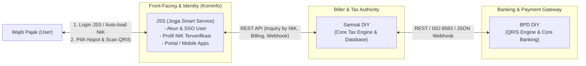
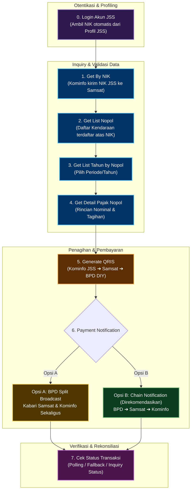
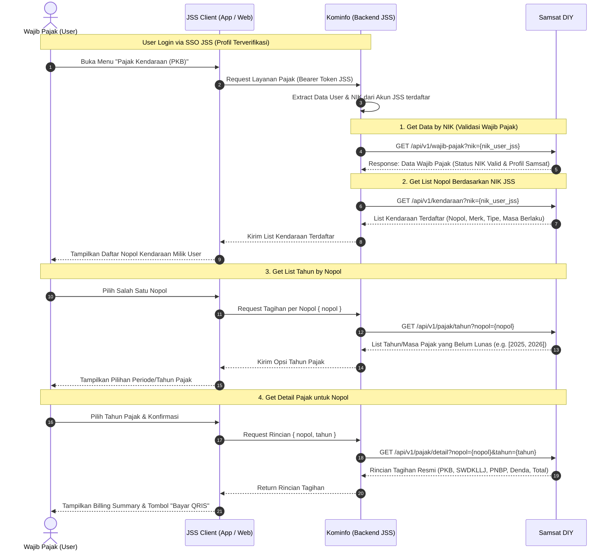
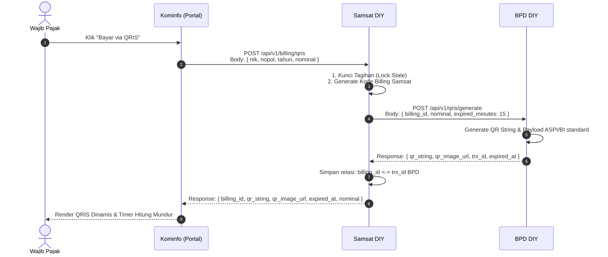
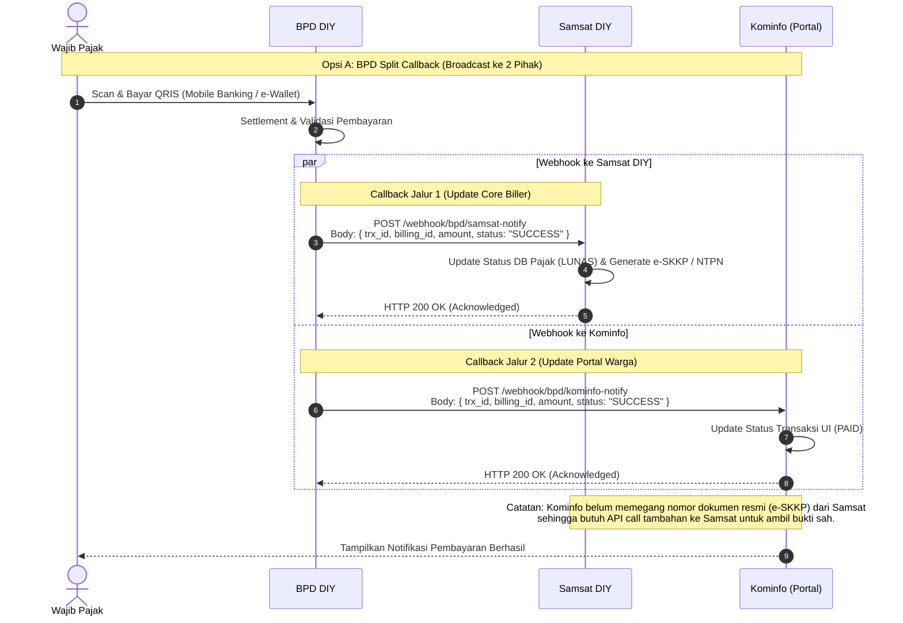
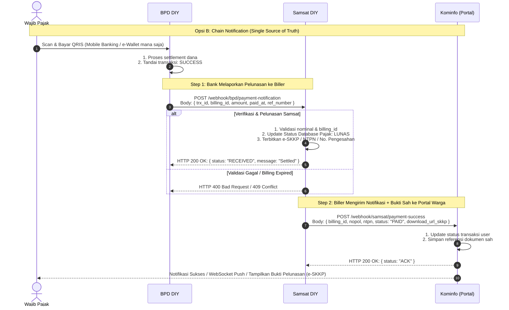
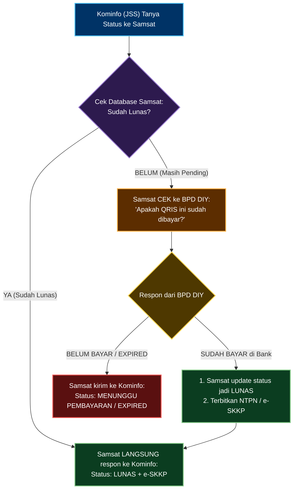
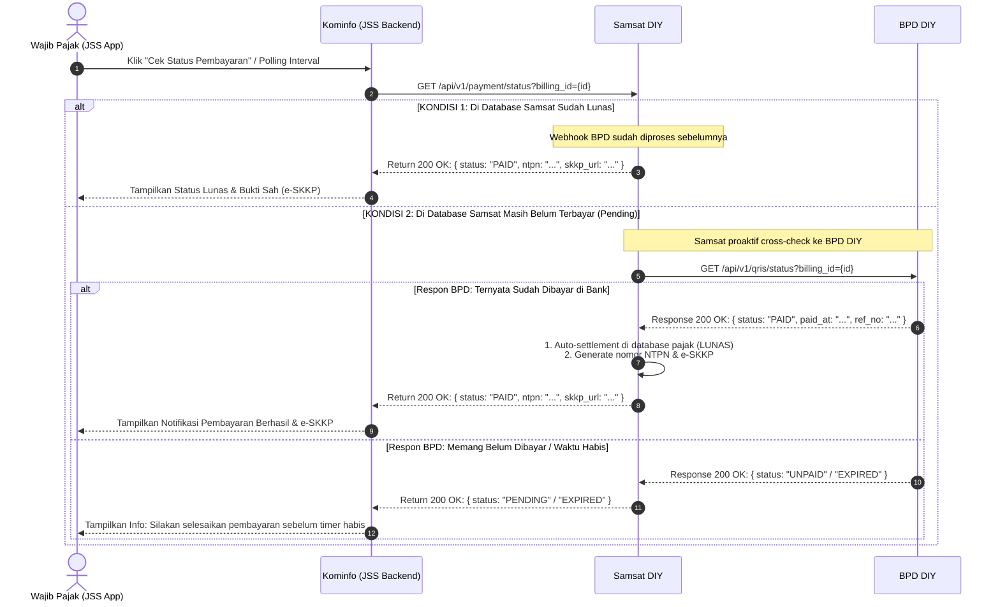

# Blueprint Integrasi Pembayaran Pajak Kendaraan Bermotor (PKB)
**Pemerintah Provinsi DIY: Kominfo – Samsat – BPD DIY**
*Skema Pembayaran: Komparasi Opsi A (Split Broadcast) & Opsi B (Chain Notification)*

---

## 1. Ringkasan Eksekutif & Arsitektur Solusi

Dokumen ini menjelaskan rancangan cetak biru (*blueprint*) teknis untuk alur integrasi pembayaran pajak kendaraan bermotor. Integrasi melibatkan entitas utama:
1. **Wajib Pajak (Pengguna JSS)**: Warga yang telah memiliki akun terverifikasi di **Jogja Smart Service (JSS)**.
2. **Dinas Komunikasi dan Informatika (Kominfo / Portal JSS)**: Penyedia kanal layanan publik (SuperApp JSS / SSO Identity Provider & App Server) yang menyimpan profil kependudukan terverifikasi (termasuk NIK).
3. **Samsat DIY**: Otoritas pengelola data perpajakan kendaraan bermotor dan pencetakan bukti bayar/e-SKKP/e-TBPKP (*Core Biller*).
4. **BPD DIY**: Institusi perbankan persepsi dan penyedia gerbang pembayaran QRIS (*Payment Gateway / Acquirer*).

---

## 2. Arsitektur Komponen & Aliran Data

---

## 3. Alur Proses End-to-End (High-Level Process)

---

## 4. Rincian Alur & Spesifikasi Interaksi (Sequence Diagrams)

### 4.1. Tahap 1 - 4: Inquiry dan Pemilihan Objek Pajak (Berbasis Akun JSS)
Karena pengguna telah terotentikasi di aplikasi JSS (Jogja Smart Service), **pengguna tidak perlu lagi mengetik NIK secara manual**. NIK langsung diambil dari sesi/token profil akun JSS terverifikasi dan diteruskan ke Samsat.

---

### 4.2. Tahap 5: Pembuatan Billing & QRIS Dinamis
Kominfo meminta kode billing ke Samsat, dan Samsat meneruskan parameter nominal ke BPD DIY untuk pembuatan *Dynamic QRIS* (NMID BPD DIY).

---

### 4.3. Tahap 6: Eksekusi Pembayaran (Payment Execution)

#### **Opsi A: BPD Split Callback (BPD Mengabari Samsat & Kominfo Secara Terpisah)**

> [!WARNING] Catatan Evaluasi Opsi A:
> - **Kelebihan**: Notifikasi ke Kominfo datang secara langsung dari BPD sehingga respons UI bisa lebih cepat.
> - **Kekurangan / Risiko**: 
>   1. **Risiko Inkonsistensi Data (Race Condition)**: Kominfo menerima info SUKSES padahal Samsat bisa jadi mengalami kegagalan saat proses *commit database* atau penerbitan nomor pengesahan (NTPN/e-SKKP).
>   2. **Beban BPD**: BPD DIY harus mengelola 2 URL endpoint callback terpisah dan menangani retry terpisah untuk tiap institusi.

---

#### **Opsi B: Chain Notification (BPD ➔ Samsat ➔ Kominfo) — [DIREKOMENDASIKAN]**

> [!TIP] Catatan Evaluasi Opsi B:
> - **Single Source of Truth**: Samsat memvalidasi dan membukukan pelunasan terlebih dahulu serta langsung melampirkan nomor NTPN dan tautan unduh e-SKKP sebelum mengabari Kominfo.
> - **Integritas Terjamin**: Kominfo dipastikan hanya menampilkan status lunas jika sistem legalitas Samsat telah sukses menerbitkan bukti sah.
> - **Arsitektur Rapi**: BPD hanya berkomunikasi dengan Samsat (standar B2B Biller Bank).

---

### 4.4. Tahap 7: Pengecekan Status Transaksi (Fallback / Polling / Auto-Reconcile)

Mekanisme ini bekerja sebagai penjamin konsistensi (*self-healing*) jika webhook mengalami delay/gangguan jaringan, atau saat pengguna menekan tombol "Cek Status" di aplikasi JSS.

#### **Logika Bisnis Pengecekan Status:**
1. **Kominfo (JSS)** hanya bertanya ke satu pintu: **Samsat DIY**.
2. **Jika database Samsat sudah Lunas**: Samsat langsung membalas ke Kominfo (tanpa beban request ke BPD).
3. **Jika database Samsat masih Belum Lunas (Pending)**: Samsat proaktif melakukan cross-check ke BPD DIY untuk memastikan status QRIS mutakhir:
   - Jika BPD menyatakan **Sudah Bayar**: Samsat seketika melakukan pelunasan otomatis (*auto-settle*), menerbitkan e-SKKP, dan mengembalikan status **PAID** ke Kominfo.
   - Jika BPD menyatakan **Belum Bayar / Expired**: Samsat mengembalikan status **PENDING / EXPIRED** ke Kominfo.

#### **Flowchart Logika Keputusan Cek Status:**

#### **Sequence Diagram Interaksi API Cek Status:**

---

## 5. Ringkasan Desain API & Kontrak Data

| No | Endpoint | Pengirim | Penerima | Skema | Fungsi Utama |
|---|---|---|---|---|---|
| 1 | `GET /api/v1/wajib-pajak?nik={nik}` | Kominfo | Samsat | Semua | Verifikasi data kepemilikan NIK |
| 2 | `GET /api/v1/kendaraan?nik={nik}` | Kominfo | Samsat | Semua | Mengambil daftar nopol yang terikat pada NIK |
| 3 | `GET /api/v1/pajak/tahun?nopol={nopol}` | Kominfo | Samsat | Semua | Mengambil daftar tahun pajak tertunggak/berjalan |
| 4 | `GET /api/v1/pajak/detail?nopol={nopol}&tahun={tahun}` | Kominfo | Samsat | Semua | Menghitung rincian kewajiban pembayaran |
| 5 | `POST /api/v1/billing/qris` | Kominfo | Samsat | Semua | Permintaan pembuatan billing dan QRIS |
| 6 | `POST /api/v1/qris/generate` | Samsat | BPD DIY | Semua | Request penerbitan QR string resmi |
| 7a | `POST /webhook/bpd/samsat-notify` | BPD DIY | Samsat | Opsi A | Webhook notifikasi bayar dari BPD ke Samsat |
| 7b | `POST /webhook/bpd/kominfo-notify` | BPD DIY | Kominfo | Opsi A | Webhook notifikasi bayar dari BPD ke Kominfo |
| 8a | `POST /webhook/bpd/payment-notification` | BPD DIY | Samsat | Opsi B | Notifikasi pelunasan tunggal dari BPD ke Biller |
| 8b | `POST /webhook/samsat/payment-success` | Samsat | Kominfo | Opsi B | Notifikasi berantai dari Samsat ke Portal Kominfo (+ e-SKKP) |
| 9 | `GET /api/v1/payment/status?billing_id={id}` | Kominfo | Samsat | Semua | Verifikasi status pembayaran berkala/fallback |
| 10 | `GET /api/v1/qris/status?trx_id={trx_id}` | Samsat | BPD DIY | Semua | Konfirmasi status ke core bank |

---

## 6. Aspek Keamanan & Ketahanan Sistem (Reliability)

1. **Keamanan Transaksi**:
   - Komunikasi antar-server menggunakan **mTLS** atau **HTTPS + Signature Token (HMAC SHA-256)**.
   - Pemanfaatan *IP Whitelisting* untuk akses endpoint webhook.
2. **Idempotensi (Idempotency Key)**:
   - Webhook harus bersifat idempotent menggunakan `billing_id` atau `trx_id` guna mengantisipasi pengiriman ulang (*duplicate/retry callback*).
3. **Masa Berlaku Tagihan & Billing Timeout**:
   - Dynamic QRIS memiliki TTL (Time-To-Live) terbatas (misal: 15–30 menit).
   - Jika waktu habis tanpa pelunasan, Samsat melepaskan *lock* pada tagihan kendaraan.
4. **Retry Mechanism & Dead-Letter Queue (DLQ)**:
   - Jika sistem penerima webhook mengalami *downtime*, pengirim webhook menerapkan mekanisme antrean coba-ulang (*exponential backoff*).

