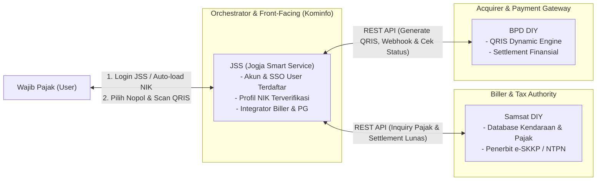
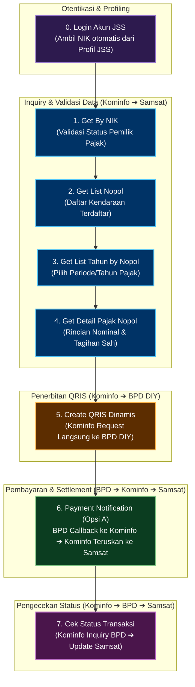
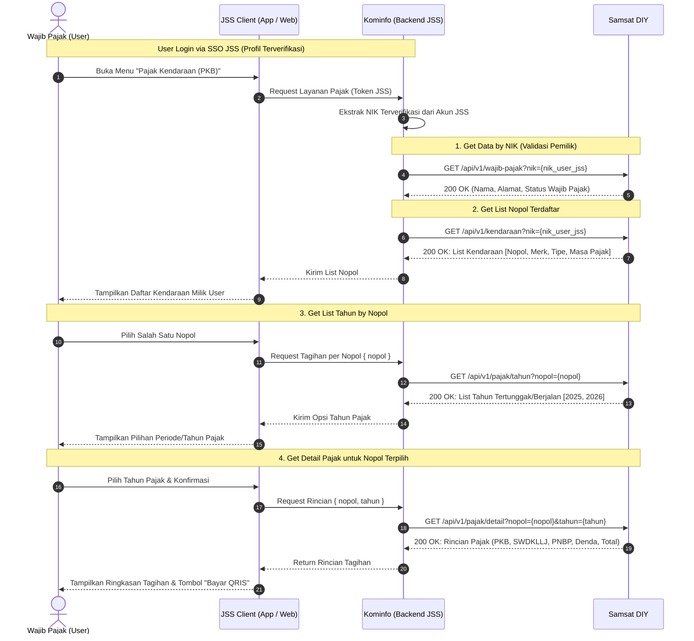
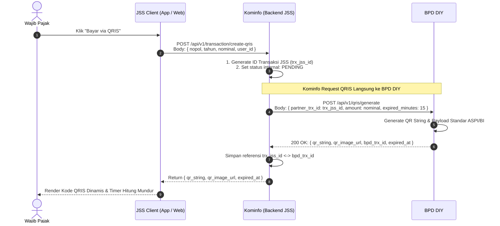
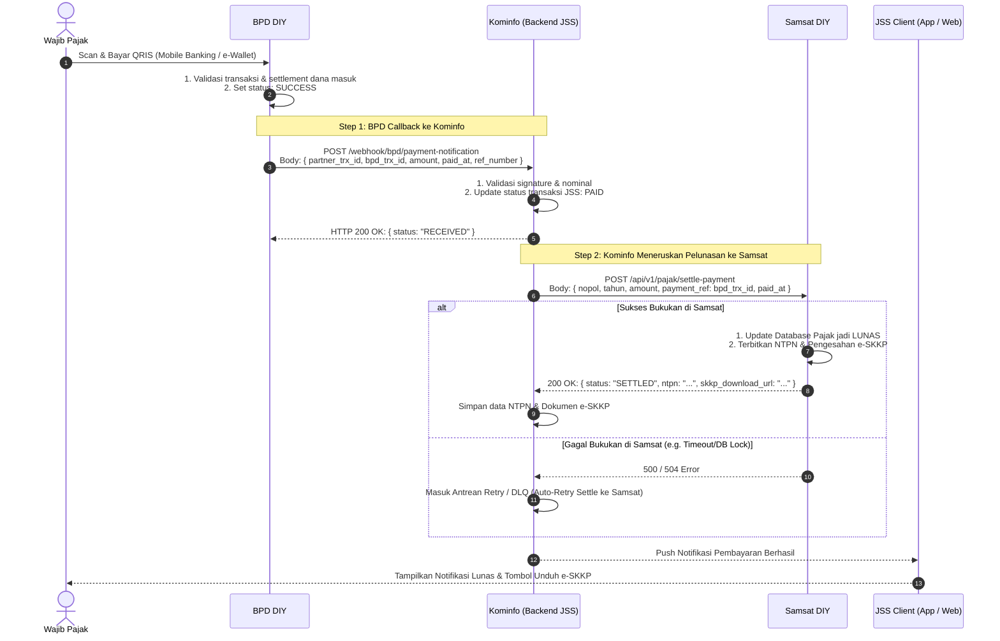
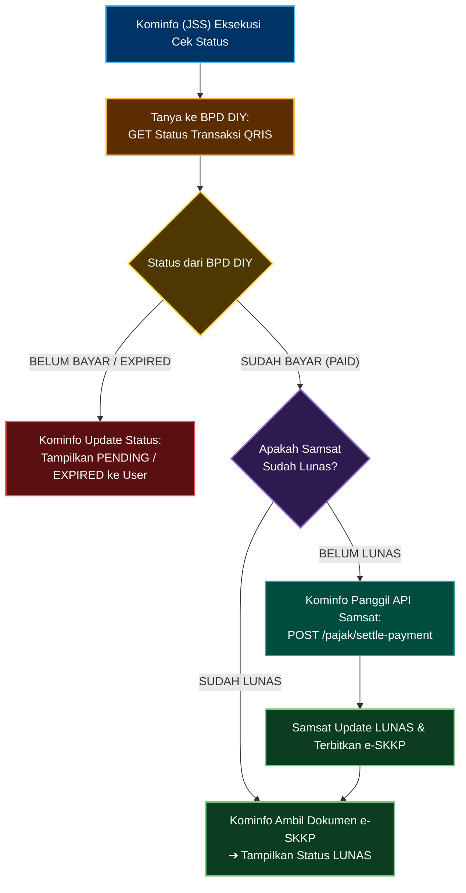
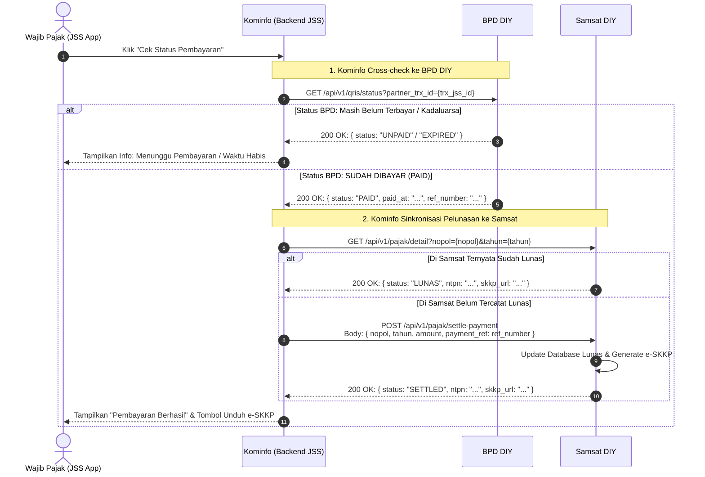

# Blueprint Integrasi Pembayaran Pajak Kendaraan Bermotor (PKB)
**Pemerintah Provinsi DIY: Kominfo – Samsat – BPD DIY**
*Skema Pembayaran: Kominfo Direct to Bank (Kominfo ➔ BPD Direct Integration)*

---

## 1. Ringkasan Eksekutif & Karakteristik Arsitektur

Dokumen ini menjelaskan rancangan cetak biru (*blueprint*) teknis untuk skema alternatif di mana **Kominfo (JSS)** bertindak sebagai agregator/orkestrator utama (*Hub / Gateway*) yang menghubungkan langsung kanal perpajakan **Samsat DIY** dengan kanal perbankan **BPD DIY**.

### Karakteristik Utama Skema Ini:
1. **Inquiry (Tahap 1–4)**: Jalur murni antara **Kominfo (JSS)** dan **Samsat DIY** untuk validasi identitas NIK JSS, daftar nopol kendaraan, daftar tahun pajak terutang, serta rincian nominal tagihan resmi.
2. **Create QRIS (Tahap 5)**: **Kominfo langsung menembak API BPD DIY** untuk generate Dynamic QRIS (tanpa melalui Samsat).
3. **Payment Notification (Tahap 6 - Opsi A)**: BPD DIY mengirim callback pelunasan ke **Kominfo**, kemudian **Kominfo yang meneruskan pelunasan ke Samsat DIY** untuk update status lunas dan meminta penerbitan bukti sah (e-SKKP / NTPN).
4. **Cek Status (Tahap 7)**: Kominfo melakukan sinkronisasi status ke **BPD DIY** terlebih dahulu untuk konfirmasi finansial, lalu jika terbukti lunas mengabari/settle ke **Samsat DIY**.

---

## 2. Arsitektur Komponen & Aliran Data

---

## 3. Alur Proses End-to-End (High-Level Process)

---

## 4. Rincian Alur & Spesifikasi Interaksi (Sequence Diagrams)

### 4.1. Tahap 1 - 4: Inquiry dan Pemilihan Objek Pajak (Kominfo – Samsat)
User masuk via SSO JSS, NIK terverifikasi diambil langsung oleh server Kominfo untuk mengecek data kendaraan ke Samsat DIY.

---

### 4.2. Tahap 5: Create QRIS (Kominfo – BPD DIY Direct)
Pada skema ini, **Kominfo langsung menembak API BPD DIY** untuk pembuatan QRIS Dinamis menggunakan ID Referensi / Tagihan dari Kominfo.

---

### 4.3. Tahap 6: Payment Execution (BPD ➔ Kominfo ➔ Samsat)
Alur ketika Wajib Pajak membayar QRIS, BPD mengabari Kominfo via webhook, lalu Kominfo melanjutkan instruksi pelunasan ke Samsat DIY.

---

### 4.4. Tahap 7: Pengecekan Status Transaksi (Kominfo ➔ BPD ➔ Samsat)
Mekanisme ketika pengguna menekan tombol "Cek Status" di aplikasi JSS atau auto-polling berjalan saat webhook tertunda.

#### **Logika Bisnis Cek Status:**
1. **Kominfo (JSS)** mengecek terlebih dahulu ke **BPD DIY**: *"Apakah dana untuk QRIS ini sudah masuk/terbayar?"*
2. **Jika BPD menyatakan BELUM BAYAR / EXPIRED**:
   - Kominfo langsung mengembalikan status `PENDING` atau `EXPIRED` ke aplikasi user.
3. **Jika BPD menyatakan SUDAH BAYAR (PAID)**:
   - Kominfo memeriksa apakah data di **Samsat DIY** sudah lunas.
   - Jika Samsat belum lunas (belum ter-settle), Kominfo langsung memicu settlement ke Samsat DIY (`POST /api/v1/pajak/settle-payment`).
   - Samsat membukukan lunas, menerbitkan e-SKKP, dan Kominfo menampilkan status Lunas ke user.

#### **Flowchart Logika Cek Status:**

#### **Sequence Diagram Interaksi API Cek Status:**

---

## 5. Ringkasan Desain API & Kontrak Data

| No | Endpoint | Pengirim | Penerima | Fungsi Utama |
|---|---|---|---|---|
| 1 | `GET /api/v1/wajib-pajak?nik={nik}` | Kominfo | Samsat | Verifikasi data kepemilikan NIK JSS |
| 2 | `GET /api/v1/kendaraan?nik={nik}` | Kominfo | Samsat | Mengambil daftar nopol yang terikat pada NIK |
| 3 | `GET /api/v1/pajak/tahun?nopol={nopol}` | Kominfo | Samsat | Mengambil daftar tahun pajak tertunggak/berjalan |
| 4 | `GET /api/v1/pajak/detail?nopol={nopol}&tahun={tahun}` | Kominfo | Samsat | Mengambil rincian kewajiban pajak resmi |
| 5 | `POST /api/v1/qris/generate` | Kominfo | BPD DIY | Permintaan pembuatan dynamic QRIS langsung ke bank |
| 6 | `POST /webhook/bpd/payment-notification` | BPD DIY | Kominfo | Webhook notifikasi pembayaran dari BPD ke Kominfo |
| 7 | `POST /api/v1/pajak/settle-payment` | Kominfo | Samsat | Kominfo membukukan pelunasan & meminta e-SKKP ke Samsat |
| 8 | `GET /api/v1/qris/status?partner_trx_id={id}` | Kominfo | BPD DIY | Inquiry status transaksi perbankan BPD DIY |

---

## 6. Pertimbangan Teknis & Mitigasi Risiko

1. **Kominfo Menjadi Single Point of Coordination**:
   - Karena Kominfo yang menghubungkan BPD dan Samsat, Kominfo **wajib mengimplementasikan mekanisme antrean (*Message Queue / Job Worker*)** untuk penyelesaian ke Samsat.
2. **Penanganan Kasus Gagal Settle ke Samsat**:
   - Jika uang sudah sukses dipotong di BPD DIY tetapi API Samsat sedang mengalami *timeout* atau *maintenance*, Kominfo mencatat status `PAID_PENDING_SETTLEMENT` dan otomatis melakukan retry berkala hingga Samsat mengonfirmasi penerbitan e-SKKP.
3. **Idempotensi Pelunasan di Samsat**:
   - Endpoint `POST /api/v1/pajak/settle-payment` di Samsat wajib bersifat *idempotent* berbasis `payment_ref` atau `bpd_trx_id` agar panggilan berulang tidak menimbulkan pembukuan ganda.

