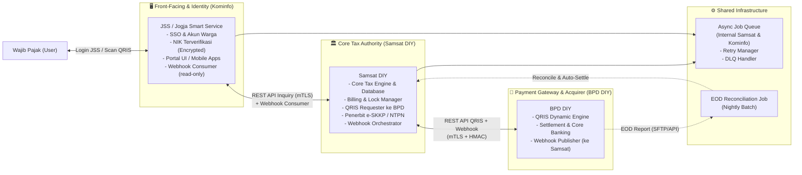
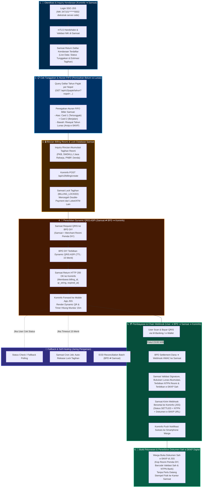
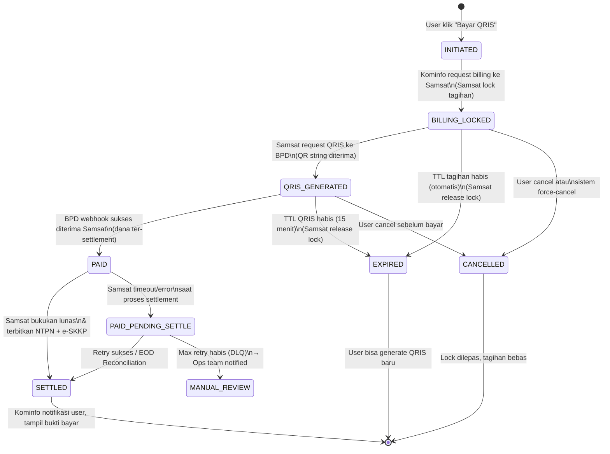
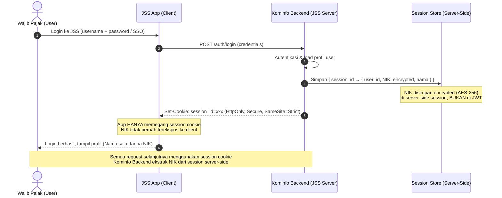
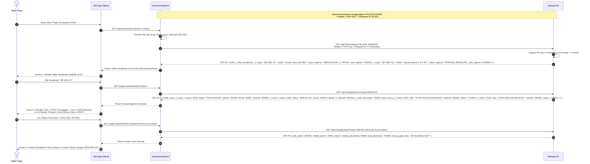
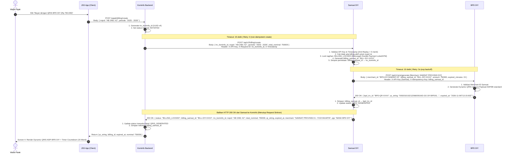
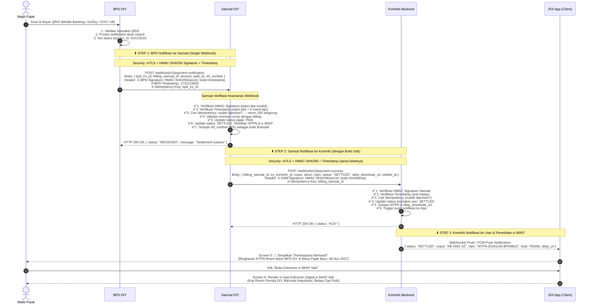
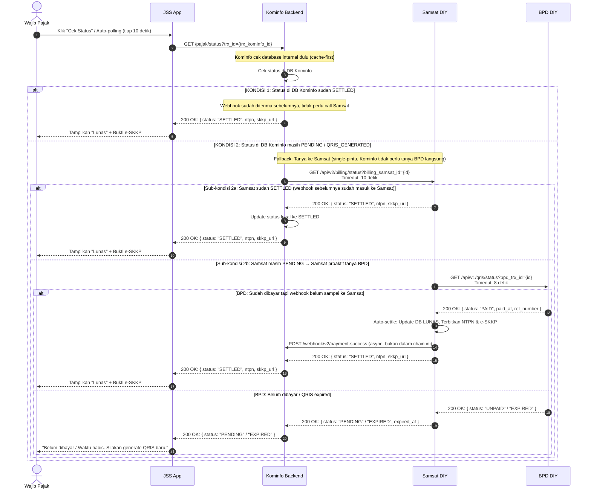
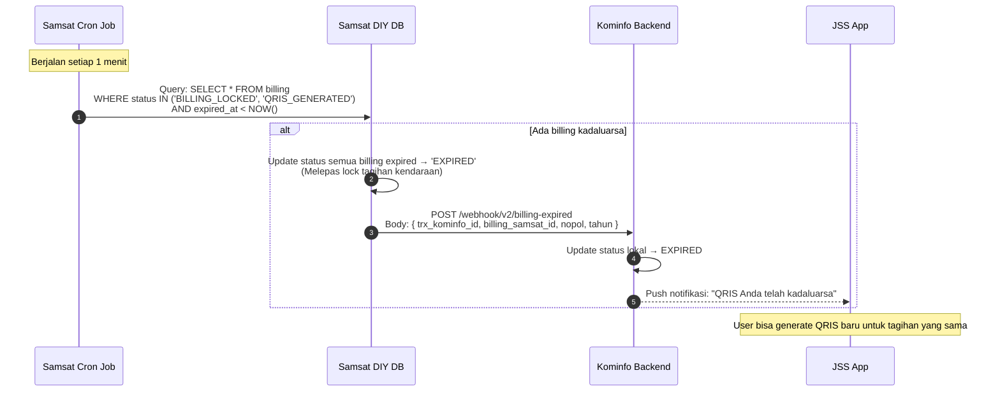
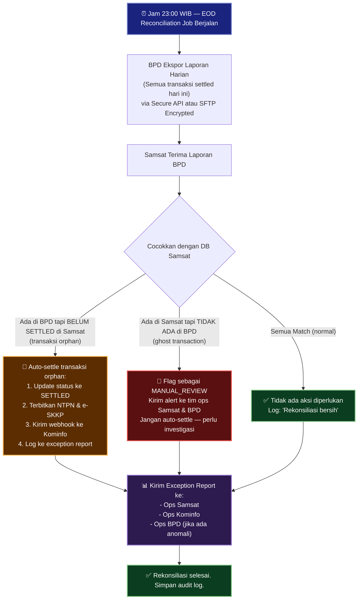

# Blueprint Integrasi Pembayaran Pajak Kendaraan Bermotor (PKB)
**Pemerintah Provinsi DIY: Kominfo – Samsat – BPD DIY**
*Skema Optimal: Kominfo-as-Portal / Samsat-Orchestrated Chain (Versi Hardened)*

> **Status Dokumen**: Blueprint Teknis v1.0 — Rekomendasi Final
> **Tanggal**: November 2026
> **Berdasarkan**: Audit & Review Blueprint A (Chain Notification) + Blueprint B (Kominfo Direct)

---

## 1. Filosofi & Prinsip Desain

Skema optimal ini dibangun di atas **5 prinsip utama**:

| Prinsip | Deskripsi |
|---|---|
| **Kominfo = Portal, Bukan Orchestrator** | Kominfo hanya sebagai kanal UI/UX dan identity provider. Tidak menyentuh logika keuangan atau pembayaran secara langsung. |
| **Samsat = Single Source of Truth Pajak** | Semua status pajak (lunas/belum) **hanya sah** jika sudah tercatat di database Samsat. |
| **BPD = Pemilik Kebenaran Finansial** | Status finansial (uang sudah masuk/belum) hanya dipegang BPD. Tidak ada pihak lain yang men-declare "sudah bayar" tanpa konfirmasi BPD. |
| **Defense-in-Depth Security** | Setiap titik komunikasi antar-sistem diamankan berlapis: mTLS + HMAC Signature + IP Whitelist + Timestamp Anti-Replay. |
| **Self-Healing by Design** | Sistem harus mampu pulih otomatis dari kondisi partial failure tanpa intervensi manual untuk transaksi normal. |

---

## 2. Arsitektur Komponen & Aliran Data



---

## 3. Alur Proses End-to-End (High-Level 6 Langkah)



---

## 4. State Machine Resmi Status Transaksi

> [!IMPORTANT] Semua sistem (Kominfo, Samsat, BPD) WAJIB menggunakan state machine ini sebagai referensi tunggal. Transisi di luar diagram ini dianggap **invalid** dan harus ditolak.



**Tabel Transisi & Actor:**

| Dari Status | Ke Status | Trigger Event | Actor Berwenang |
|---|---|---|---|
| `INITIATED` | `BILLING_LOCKED` | User klik bayar → Kominfo request → Samsat lock berhasil | Samsat |
| `BILLING_LOCKED` | `QRIS_GENERATED` | Samsat request ke BPD, QR string diterima | Samsat |
| `QRIS_GENERATED` | `PAID` | BPD webhook payment success diterima Samsat | BPD (via webhook) |
| `PAID` | `SETTLED` | Samsat sukses bukukan lunas & terbitkan e-SKKP | Samsat |
| `SETTLED` | *(akhir)* | Kominfo notifikasi user | Kominfo |
| `BILLING_LOCKED` | `EXPIRED` | Scheduler job Samsat (otomatis per TTL) | Samsat (cron) |
| `QRIS_GENERATED` | `EXPIRED` | QRIS TTL 15 menit habis (otomatis) | Samsat (cron) |
| `PAID` | `PAID_PENDING_SETTLE` | Samsat error saat proses settlement ke DB | Samsat |
| `PAID_PENDING_SETTLE` | `SETTLED` | Retry sukses atau EOD Reconciliation | Samsat (retry/batch) |
| `PAID_PENDING_SETTLE` | `MANUAL_REVIEW` | Max retry habis (masuk DLQ) | System → Ops |

---

## 5. Rincian Alur & Spesifikasi Interaksi

### 5.1. Tahap 0: Autentikasi & Identity — Proteksi Data NIK

> [!IMPORTANT] Prinsip UU PDP No. 27/2022
> NIK adalah **data pribadi sensitif**. NIK **tidak boleh** ada di JWT token yang diterima client/app. NIK hanya boleh ada di server-side session Kominfo dan hanya dikirim ke Samsat via backend-to-backend channel yang terenkripsi.



---

### 5.2. Tahap 1–4: Inquiry Data Pajak & Penegakan Aturan FIFO (Kominfo → Samsat)

> [!IMPORTANT] Penegakan Aturan FIFO Biller Samsat & Akumulasi Multi-Tahun
> Berdasarkan regulasi perpajakan daerah DIY, wajib pajak **tidak diperkenankan melompati tahun pajak tertunggak**. Pembayaran wajib dilakukan secara berurutan (*First In, First Out / FIFO*). Jika terdapat tunggakan 2 tahun (misal: 2025 tertunggak + 2026 berjalan), tagihan disatukan dalam **satu kode billing akumulasi** dan dilunasi sekaligus via satu QRIS BPD DIY.



---

### 5.3. Tahap 5: Generate Billing & Dynamic QRIS ASPI (Kominfo → Samsat → BPD)

> [!NOTE] Mengapa Samsat yang request ke BPD (bukan Kominfo)?
> Samsat adalah **Merchant resmi** BPD DIY berdasarkan perjanjian kerjasama perbankan rekening RKUD Pemda DIY. Kominfo bukan PJP (Penyelenggara Jasa Pembayaran) dan tidak memiliki izin BI untuk menerbitkan instrumen pembayaran. Skema ini patuh 100% pada regulasi Bank Indonesia.



**Penanganan Kasus Error Generate Billing:**

| Kondisi | Respons Samsat | Aksi Kominfo |
|---|---|---|
| Sudah ada billing aktif untuk nopol+tahun | `409 Conflict: { existing_billing_id, expired_at }` | Tampilkan QRIS yang sudah ada (jika belum expired) |
| Tagihan tidak ditemukan / lunas | `404 Not Found` | Tampilkan pesan "Tagihan tidak ditemukan atau sudah lunas" |
| BPD timeout saat generate QRIS | `503 Service Unavailable` | Kominfo tampilkan "Coba lagi dalam beberapa saat" |
| NIK tidak cocok dengan nopol | `403 Forbidden` | Tampilkan "Kendaraan ini tidak terdaftar atas nama Anda" |

---

### 5.4. Tahap 6: Eksekusi Pembayaran & Chain Notification (BPD → Samsat → Kominfo)

> [!TIP] Ini adalah inti dari skema "Kominfo-as-Portal": Kominfo **hanya menerima notifikasi final yang sudah divalidasi** dari Samsat. Tidak perlu menyentuh logika settlement sama sekali.



---

### 5.4.1. Spesifikasi Dokumen Sah Elektronik e-SKKP (In-App Digital Viewer)

> [!TIP] Efisiensi Pelayanan Publik (Paperless & Keabsahan Hukum Penuh)
> Surat Ketetapan Kewajiban Pembayaran Elektronik (**e-SKKP**) yang diterbitkan oleh Samsat DIY melalui JSS memiliki kekuatan hukum yang sah dan setara dengan SKKP cetak fisik berdasarkan UU ITE No. 1/2024 dan Peraturan Gubernur DIY:
> 1. **Kop Resmi**: Pemerintah Daerah D.I. Yogyakarta – Badan Pengelola Keuangan dan Aset Daerah (BPKAD) – Samsat DIY.
> 2. **Tervalidasi Bank Persepsi**: Tercantum Nomor Transaksi Pembayaran Pajak (**NTPN**) unik dari Bank BPD DIY (`NTPN-20261106-BPD9812`).
> 3. **Barcode QR Verifikasi Sah**: Dapat dipindai sewaktu-waktu oleh petugas kepolisian lalu lintas saat pemeriksaan di jalan tanpa memerlukan stempel cap basah fisik ke kantor Samsat.
> 4. **Arsip Digital Permanen**: Tersimpan permanen di akun JSS warga dan dapat diunduh (PDF) atau dibagikan kapan saja.

---

### 5.5. Spesifikasi Keamanan Webhook (HMAC Verification)

Setiap webhook yang masuk harus diverifikasi dengan pseudocode berikut:

```
// PENERIMA WEBHOOK (Samsat atau Kominfo)

function verifyWebhook(request):
    // 1. Ambil komponen dari header
    received_signature = request.headers["X-Signature"]
    received_timestamp = request.headers["X-Timestamp"]  // Unix timestamp (integer)
    
    // 2. Anti-Replay Attack: tolak jika timestamp > 5 menit lalu
    current_time = now_unix_timestamp()
    if abs(current_time - received_timestamp) > 300:  // 300 detik = 5 menit
        return HTTP 401 Unauthorized ("Timestamp expired")
    
    // 3. Reconstruct & Verify Signature
    raw_body = request.raw_body_string  // body sebelum di-parse JSON
    expected_signature = HMAC_SHA256(shared_secret_key, raw_body + received_timestamp)
    
    if not constant_time_equal(received_signature, expected_signature):
        return HTTP 401 Unauthorized ("Invalid signature")
    
    // 4. Idempotency Check
    idempotency_key = request.headers["X-Idempotency-Key"]
    if already_processed(idempotency_key):
        return HTTP 200 OK ("Already processed")  // return sukses, jangan error
    
    // 5. Lanjutkan proses bisnis
    process_payment_notification(request.body)
    mark_as_processed(idempotency_key)
    return HTTP 200 OK
```

---

### 5.6. Tahap 7: Status Check & Self-Healing Fallback

Mekanisme ini aktif ketika: (a) pengguna klik "Cek Status", atau (b) auto-polling dari app setiap 10 detik selama QRIS aktif.



---

### 5.7. Tahap 8: Mekanisme Unlock & Cancel Billing

Ini adalah fitur **yang tidak ada di Blueprint A & B** namun kritis untuk menghindari tagihan terkunci permanen.



**Endpoint Cancel Manual (opsional, untuk user yang sadar ingin cancel):**

```
DELETE /api/v2/billing/{billing_samsat_id}
Pengirim: Kominfo
Penerima: Samsat

Response sukses: 200 OK { status: "CANCELLED", message: "Tagihan dibatalkan" }
Response jika sudah PAID: 409 Conflict { message: "Tagihan sudah dibayar, tidak bisa dibatalkan" }
```

---

### 5.8. Tahap 9: EOD Reconciliation (Jaring Pengaman Akhir)

> [!TIP] EOD Reconciliation adalah lapisan terakhir yang menjamin **tidak ada transaksi yang "jatuh ke celah"** antara sistem BPD, Samsat, dan Kominfo — bahkan jika semua retry sudah habis.



---

## 6. Ringkasan Desain API & Kontrak Data (Versi Final)

### 6.1. Daftar Endpoint Lengkap

| No | Endpoint | Versi | Pengirim | Penerima | Fungsi & Deskripsi Teknis |
|---|---|---|---|---|---|
| 1 | `GET /api/v2/wajib-pajak?nik={nik}` | v2 | Kominfo | Samsat | Verifikasi kepemilikan NIK terverifikasi di Samsat DIY |
| 2 | `GET /api/v2/kendaraan?nik={nik}` | v2 | Kominfo | Samsat | Daftar kendaraan aktif per NIK (status tunggakan & preview nominal) |
| 3 | `GET /api/v2/pajak/tahun?nopol={nopol}` | v2 | Kominfo | Samsat | Riwayat tahun pajak: `unpaid_years` (FIFO) & `paid_history` (Arsip) |
| 4 | `GET /api/v2/pajak/detail?nopol={nopol}&mode=accumulation` | v2 | Kominfo | Samsat | Rincian nominal resmi akumulasi Samsat (PKB, SWDKLLJ, Denda) |
| 5 | `POST /api/v2/billing/create` | v2 | Kominfo | Samsat | Request billing + lock tagihan akumulasi (Anti Double-Payment) |
| 6 | `GET /api/v2/billing/status?billing_samsat_id={id}` | v2 | Kominfo | Samsat | Cek status billing (fallback self-healing) |
| 7 | `DELETE /api/v2/billing/{billing_samsat_id}` | v2 | Kominfo | Samsat | Cancel billing & pelepasan lock sebelum bayar |
| 8 | `POST /api/v1/qris/generate` | v1 | Samsat | BPD DIY | Request QRIS dinamis ASPI oleh Samsat selaku Merchant Pemda DIY |
| 9 | `GET /api/v1/qris/status?bpd_trx_id={id}` | v1 | Samsat | BPD DIY | Inquiry status QRIS ke core banking BPD DIY |
| 10 | `POST /webhook/v2/payment-notification` | v2 | BPD DIY | Samsat | Webhook pelunasan dana BPD → Samsat (HMAC SHA-256) |
| 11 | `POST /webhook/v2/payment-success` | v2 | Samsat | Kominfo | Webhook berantai sukses Samsat → Kominfo (+ NTPN & e-SKKP) |
| 12 | `POST /webhook/v2/billing-expired` | v2 | Samsat | Kominfo | Notifikasi otomatis pelepasan lock tagihan (TTL 15 menit) |
| 13 | `GET /pajak/status?trx_id={trx_kominfo_id}` | v1 | App Client | Kominfo | Status check polling dari app user |
| 14 | *(Batch)* `GET /api/v1/eod-report?date={YYYY-MM-DD}` | v1 | Samsat | BPD DIY | Laporan rekonsiliasi harian (Nightly Batch) |

### 6.2. Canonical Idempotency Key per Tahap

> [!IMPORTANT] Semua pihak WAJIB menggunakan key yang sama untuk idempotency check.

| Tahap | Canonical Idempotency Key | Disimpan oleh |
|---|---|---|
| Generate Billing (Kominfo → Samsat) | `trx_kominfo_id` (UUID, dibuat Kominfo) | Samsat & Kominfo |
| Generate QRIS (Samsat → BPD) | `billing_samsat_id` (UUID, dibuat Samsat) | BPD & Samsat |
| Webhook BPD → Samsat | `bpd_trx_id` (dibuat BPD, source of truth finansial) | Samsat |
| Webhook Samsat → Kominfo | `billing_samsat_id` | Kominfo |
| Cancel Billing | `billing_samsat_id` | Samsat |

---

### 6.3. Standar Payload API Sesuai Prototype Implementasi

#### A. Response `GET /api/v2/kendaraan?nik=...` (Step 1)
```json
{
  "status": "SUCCESS",
  "nik": "347101******0002",
  "nama_pemilik": "RADEN MAS DANANG P.",
  "total_kendaraan": 2,
  "data_kendaraan": [
    {
      "nopol": "AB 2481 XZ",
      "merk": "Honda",
      "tipe": "Vario 160 ABS (2022)",
      "no_rangka": "MH1KF8123NK098124",
      "no_mesin": "KF81E1928371",
      "masa_pajak": "28 Nov 2026",
      "status_tagihan": "MENUNGGAK_2_TAHUN",
      "tagihan": {
        "periode_akumulasi": [2025, 2026],
        "total_nominal": 750000,
        "ada_denda": true
      }
    },
    {
      "nopol": "AB 1892 YQ",
      "merk": "Toyota",
      "tipe": "Avanza 1.5 G MT (2021)",
      "no_rangka": "MHFM2BA31NK019821",
      "no_mesin": "2NRE8192831",
      "masa_pajak": "15 Apr 2027",
      "status_tagihan": "PERIODE_BERJALAN",
      "tagihan": {
        "periode_akumulasi": [2027],
        "total_nominal": 2450000,
        "ada_denda": false
      }
    }
  ]
}
```

#### B. Response `GET /api/v2/pajak/tahun?nopol=AB2481XZ` (Step 2 - Aturan FIFO)
```json
{
  "nopol": "AB 2481 XZ",
  "unpaid_years": [
    {
      "card_num": 1,
      "tahun": 2025,
      "status": "TERTUNGGAK",
      "label": "[Card 1] Tahun Pajak 2025 (Tertunggak 12 Bulan)",
      "jatuh_tempo": "28 November 2025",
      "pokok_pkb_swdkllj": 350000,
      "denda": 50000,
      "subtotal": 400000
    },
    {
      "card_num": 2,
      "tahun": 2026,
      "status": "BERJALAN",
      "label": "[Card 2] Tahun Pajak 2026 (Periode Berjalan)",
      "jatuh_tempo": "28 November 2026",
      "pokok_pkb_swdkllj": 350000,
      "denda": 0,
      "subtotal": 350000
    }
  ],
  "total_akumulasi": 750000,
  "paid_history": [
    {
      "tahun": 2024,
      "nominal": 335000,
      "ntpn": "NTPN-20241120-BPD6190",
      "status": "LUNAS",
      "tgl_bayar": "20 November 2024"
    },
    {
      "tahun": 2023,
      "nominal": 330000,
      "ntpn": "NTPN-20231118-BPD5102",
      "status": "LUNAS",
      "tgl_bayar": "18 November 2023"
    }
  ]
}
```

#### C. Request & Response `POST /api/v2/billing/create` (Step 3 & 4)
**Request (Kominfo ➔ Samsat):**
```json
{
  "trx_kominfo_id": "trx-jss-1793943787788",
  "nopol": "AB 2481 XZ",
  "periode": "2025 - 2026",
  "total_nominal": 750000
}
```

**Response (Samsat ➔ Kominfo):**
```json
{
  "status": "BILLING_LOCKED",
  "billing_samsat_id": "BILL-DIY-20261106-9812",
  "trx_kominfo_id": "trx-jss-1793943787788",
  "nopol": "AB 2481 XZ",
  "periode": "2025 - 2026",
  "total_nominal": 750000,
  "qr_string": "00020101021226600016ID.GO.DIY.BPD01...",
  "expired_at": "2026-11-06T13:15:00Z",
  "merchant": "SAMSAT PROVINSI D.I. YOGYAKARTA",
  "pjp": "BANK BPD DIY"
}
```

#### D. Webhook Chain `POST /webhook/v2/payment-success` (Step 5 & 6)
**Samsat ➔ Kominfo:**
```json
{
  "billing_samsat_id": "BILL-DIY-20261106-9812",
  "nopol": "AB 2481 XZ",
  "periode": "2025 - 2026",
  "ntpn": "NTPN-20261106-BPD9812",
  "status": "SETTLED",
  "total_bayar": 750000,
  "masa_pajak_baru": "28 November 2027",
  "skkp_download_url": "https://samsat.jogjaprov.go.id/eskkp/download/NTPN-20261106-BPD9812"
}
```

---

## 7. Spesifikasi Keamanan Lengkap

### 7.1. Lapisan Keamanan Komunikasi Antar-Sistem

```
Lapisan 1 (Transport):  mTLS (Mutual TLS) — semua komunikasi server-to-server
Lapisan 2 (Auth):       API Key per pasangan institusi (Kominfo↔Samsat, Samsat↔BPD)
Lapisan 3 (Integrity):  HMAC-SHA256 Signature pada semua webhook body
Lapisan 4 (Anti-Replay): Timestamp validation (tolak jika > 5 menit)
Lapisan 5 (Network):    IP Whitelist di firewall/WAF masing-masing server
```

### 7.2. Spesifikasi Timeout per Endpoint

| Panggilan API | Timeout | Max Retry | Strategi Retry |
|---|---|---|---|
| Kominfo → Samsat (Inquiry) | 10 detik | 2x | Linear backoff (3 detik) |
| Kominfo → Samsat (Billing Create) | 15 detik | 0x | Non-idempotent, tidak diretry otomatis |
| Kominfo → Samsat (Status Check) | 10 detik | 2x | Linear backoff |
| Samsat → BPD (QRIS Generate) | 10 detik | 3x | Exponential backoff (2, 4, 8 detik) |
| Samsat → BPD (Status Inquiry) | 8 detik | 2x | Linear backoff |
| BPD Webhook → Samsat | 5 detik | 5x | Exponential backoff (2, 4, 8, 16, 32 detik) |
| Samsat Webhook → Kominfo | 5 detik | 5x | Exponential backoff (2, 4, 8, 16, 32 detik) |
| Samsat → Kominfo (Expired notif) | 5 detik | 3x | Exponential backoff |

### 7.3. Perlindungan Data NIK (Kepatuhan UU PDP No. 27/2022)

| Aspek | Ketentuan |
|---|---|
| **Penyimpanan di Kominfo** | NIK di-encrypt at-rest menggunakan AES-256. Disimpan hanya di server-side session, bukan di JWT yang dikirim ke client. |
| **Transmisi ke Samsat** | Hanya via backend-to-backend (mTLS). Tidak pernah via frontend atau URL parameter yang ter-log. |
| **Logging** | NIK **tidak boleh muncul** di application log dalam bentuk plaintext. Gunakan masking (e.g., `****1234`). |
| **Retensi** | Setelah sesi berakhir, NIK di-session store dihapus otomatis sesuai TTL session. |
| **Hak Akses** | Hanya service account spesifik (bukan semua developer) yang bisa akses data NIK di environment production. |

---

## 8. Arsitektur Ketahanan Sistem (Reliability Matrix)

| Skenario Failure | Dampak ke User | Mekanisme Self-Healing | Waktu Pemulihan Target |
|---|---|---|---|
| Kominfo **down** saat payment berlangsung | User tidak menerima notifikasi UI | BPD → Samsat tetap berjalan. Ketika Kominfo kembali online, Samsat retry webhook. User cek status saat buka app. | Saat Kominfo kembali online |
| Samsat **down** saat payment berlangsung | Dana masuk BPD, pajak belum ter-update | BPD retry webhook 5x. Jika semua gagal → masuk DLQ → EOD Reconciliation malam hari auto-settle. | Malam hari (EOD) |
| BPD webhook ke Samsat **delay** | User lihat status pending | User klik "Cek Status" → Samsat query ke BPD → auto-settle jika sudah bayar | < 1 menit (manual trigger) |
| **QRIS expired** (user tidak bayar dalam 15 menit) | QRIS tidak bisa discan | Samsat scheduler otomatis release lock. User generate QRIS baru. | Otomatis (cron 1 menit) |
| **Double webhook** dari BPD ke Samsat | Potensi double settle | Idempotency check di Samsat dengan `bpd_trx_id`. Request ke-2 diabaikan (return 200 OK). | Tidak ada dampak |
| Samsat webhook ke Kominfo **gagal terus** | Notifikasi tidak muncul di app | Masuk DLQ Samsat. Ops mendapat alert. User bisa cek status manual. | DLQ alert dalam < 30 menit |
| EOD Reconciliation menemukan **orphan** | Pajak user belum ter-update meski sudah bayar | Auto-settle oleh Reconciliation Job. Kominfo notifikasi user keesokan paginya. | Sebelum pukul 06:00 pagi |

---

## 9. API Versioning Policy

> [!NOTE] Semua endpoint menggunakan prefix `/v{n}/`. Versi saat ini adalah **v2** untuk Kominfo-Samsat dan **v1** untuk Samsat-BPD (mengikuti API BPD yang ada).

**Aturan Versioning:**
1. **Additive changes** (tambah field baru di response, tambah optional field di request) → **tidak butuh versi baru**, pastikan field bersifat optional.
2. **Breaking changes** (hapus field, ubah tipe data, ubah semantik) → **wajib naik versi** (`v2` → `v3`).
3. **Deprecation policy**: Versi lama tetap berjalan minimal **3 bulan** setelah versi baru tersedia. Tim consumer diberi notice H-30 hari sebelum sunset.
4. **Response envelope** standar untuk semua API:

```json
{
  "success": true,
  "data": { ... },
  "meta": {
    "request_id": "uuid-v4-dari-X-Request-ID",
    "timestamp": "2026-11-06T09:30:00+07:00",
    "api_version": "v2"
  },
  "error": null
}
```

---

## 10. Checklist Pre-Production (Siap Go-Live)

### 🔒 Security
- [ ] mTLS dikonfigurasi dan diuji di semua channel antar-server
- [ ] HMAC Secret Key di-generate per pasangan institusi (bukan satu key untuk semua)
- [ ] HMAC Secret Key disimpan di **Secrets Manager** (HashiCorp Vault / AWS Secrets Manager / Azure Key Vault) — bukan di file `.env` biasa
- [ ] IP Whitelist aktif di firewall/WAF semua server penerima webhook
- [ ] Penetration testing dilakukan oleh tim independen
- [ ] NIK tidak muncul di application log dan response yang dikirim ke client

### 🏗️ Reliability
- [ ] State Machine diimplementasikan dan semua transisi invalid ditolak dengan log error
- [ ] Scheduler job unlock billing kadaluarsa berjalan setiap 1 menit (uji dengan scenario)
- [ ] Retry mechanism + exponential backoff aktif sesuai tabel timeout
- [ ] DLQ terkonfigurasi dan alert ke tim ops aktif
- [ ] EOD Reconciliation Job terjadwal dan telah diuji dengan data simulasi
- [ ] Monitoring dashboard aktif (jumlah transaksi, status per state, alert anomali)

### ⚖️ Regulasi & Hukum
- [ ] Konfirmasi Samsat sebagai Merchant resmi BPD DIY (bukan Kominfo)
- [ ] PKS tiga pihak sudah mencakup klausul SLA, liability, dan data sharing
- [ ] Compliance review UU PDP No. 27/2022 untuk penyimpanan NIK di JSS
- [ ] Klausul DRP (Disaster Recovery Plan) tercantum di PKS

### 🧪 Testing
- [ ] Unit test: State machine (semua transisi valid & invalid)
- [ ] Integration test: End-to-end happy path (Inquiry → Generate → Pay → Notify → Download e-SKKP)
- [ ] Integration test: Webhook gagal 5x → masuk DLQ → alert ops
- [ ] Integration test: QRIS expired → lock dilepas → user generate QRIS baru
- [ ] Integration test: Double webhook → idempotency check sukses (tidak double settle)
- [ ] Load test: Kapasitas QRIS per detik (tentukan batas & throttle)
- [ ] Disaster Recovery test: Simulasi Samsat down 30 menit lalu kembali online
- [ ] UAT: Skenario pajak dengan denda, pajak multi-tahun, kendaraan mutasi provinsi

---

## Appendix: Perbandingan Tiga Blueprint

| Aspek | Blueprint A (Original) | Blueprint B (Kominfo Direct) | **Blueprint Optimal (Ini)** |
|---|---|---|---|
| Keamanan NIK | Tidak dibahas | Tidak dibahas | ✅ Full UU PDP compliance |
| Webhook Auth | Disebut, tidak di-spec | Tidak ada | ✅ HMAC + Timestamp + Idempotency |
| State Machine | Tidak ada | Tidak ada | ✅ Formal, semua pihak pakai |
| Unlock Billing | Tidak ada | Tidak ada | ✅ Scheduler + Manual endpoint |
| Idempotency Key | Tidak konsisten | Tidak konsisten | ✅ Canonical key per tahap |
| Timeout Spec | Tidak ada | Tidak ada | ✅ Per-endpoint dengan retry |
| EOD Reconciliation | Tidak ada | Tidak ada | ✅ Nightly batch + exception report |
| API Versioning | Disebut (v1) | Disebut (v1) | ✅ Policy formal + envelope standar |
| Risiko Regulasi BI | Aman | ⚠️ PJP issue | ✅ Aman (Samsat = Merchant) |
| Beban Kominfo | Ringan | Berat | ✅ Minimal (Portal only) |
| Reliability | Baik | Risiko tinggi | ✅ Self-healing by design |

---

*Blueprint ini merupakan evolusi dari Blueprint A dan Blueprint B, menggabungkan keunggulan arsitektur Chain Notification dengan tambahan spesifikasi teknis yang hardened untuk produksi.*
*Revisi selanjutnya hanya dilakukan setelah review bersama tim teknis Kominfo, Samsat, dan BPD DIY.*

